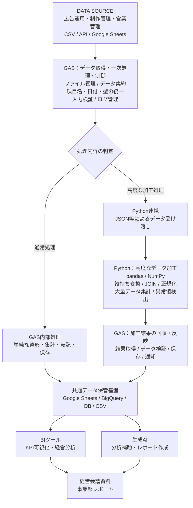

# GAS・Python連携型データ処理基盤
## システム基本設計書

**Version:** 1.0  
**Document Type:** 基本構想・アーキテクチャ設計  
**Status:** Draft

---

## 目次

1. [システム概要](#1-システム概要)
2. [システム構成](#2-システム構成)
3. [機能設計](#3-機能設計)
4. [データ処理フロー](#4-データ処理フロー)
5. [エラー・例外処理設計](#5-エラー例外処理設計)
6. [データ保管・活用設計](#6-データ保管活用設計)
7. [想定技術スタック](#7-想定技術スタック)
8. [段階的な導入計画](#8-段階的な導入計画)
9. [設計上の重要事項・今後の検討課題](#9-設計上の重要事項今後の検討課題)

---

# 1. システム概要

## 1-1. 目的

各事業部で利用されている異なるシステム・ツールから出力されるデータを集約し、共通のデータ形式に変換・統合することで、経営判断に活用可能なデータ基盤を構築する。

また、手作業によるデータ集計・整形・転記作業を自動化し、業務効率化およびデータの正確性・再現性を向上させる。

## 1-2. 基本設計方針

本システムはGASを主制御基盤とし、GASで処理しにくい高度なデータ加工のみPythonに委譲するハイブリッド構成とする。

基本方針は以下のとおり。

1. GASをデータ処理全体の制御・管理基盤とする。
2. GASで可能なデータ取得・集約・一次整地処理はGASで実施する。
3. GASで実装が煩雑になる処理や大量データ処理はPythonに委譲する。
4. Pythonの加工結果はGAS側で回収し、所定の保存先へ反映する。
5. データの加工前後を追跡できるようにし、エラー発生時の再実行を可能にする。
6. BIツールが直接利用できる共通データ形式を生成する。
7. GASとPython間のデータ連携仕様を統一し、拡張性・保守性を確保する。

---

# 2. システム構成

## 2-1. 全体アーキテクチャ



### 各レイヤーの役割

| レイヤー | 主な役割 |
|---|---|
| DATA SOURCE | 各事業部からのデータ取得元 |
| GAS | データ取得・一次整地・処理制御・運用管理 |
| Python | 高度なデータ変換・統合・分析前処理 |
| DATA STORAGE | 共通データの保管・管理 |
| BI | データの可視化・KPIモニタリング |
| AI | 分析結果の解釈・レポート作成支援 |

## 2-2. GASの処理範囲

GASはシステム全体のオーケストレーターとして機能する。

主な処理は以下のとおり。

- API・CSV・Google Sheetsからのデータ取得
- ファイルの保存・整理・管理
- 複数データソースの集約
- 項目名・日付・データ型の基本統一
- 空行・不要項目の除去
- 必須項目・入力値の検証
- GAS内処理とPython処理の振り分け
- Pythonへの処理依頼・結果回収
- 加工済みデータの保存・更新
- 処理ログ・エラーログの管理
- 処理結果の通知

## 2-3. Pythonの処理範囲

PythonはGASで実装が煩雑になる処理や、大量データ・複雑なデータ構造を扱う処理を担当する。

主な処理は以下のとおり。

- 横持ち・縦持ち変換
- 複数データの結合・JOIN
- 複雑なデータ正規化
- 大量データの集計
- 欠損値・異常値の検出
- 統計分析
- BI向けデータセットの生成

※Pythonで実施する処理は固定せず、実際のデータ形式・処理負荷に応じて追加・変更する。

---

# 3. 機能設計

## 3-1. GAS機能

| 機能 | 処理内容 |
|---|---|
| データ取得 | API・CSV・スプレッドシートからデータ取得 |
| ファイル管理 | ファイルの保存・整理・管理 |
| データ集約 | 複数データソースの統合 |
| 一次整地 | 項目名・日付・数値形式の統一 |
| 入力検証 | 必須項目・データ型・空欄チェック |
| 処理分岐 | GAS内処理またはPython処理の振り分け |
| Python連携 | API等を利用した処理依頼・結果取得 |
| 結果反映 | 加工済みデータの保存・更新 |
| ログ管理 | 処理状況・エラー内容・実行履歴の記録 |
| 通知 | エラー・処理完了等の通知 |

## 3-2. Python機能

| 機能 | 処理内容 | 使用技術 |
|---|---|---|
| データ変換 | 横持ち・縦持ち変換 | pandas.melt |
| データ結合 | 複数データのJOIN | pandas.merge |
| データ集計 | 条件別・期間別集計 | groupby |
| データ正規化 | 項目・表記・形式の統一 | pandas |
| 欠損値処理 | 欠損データの検出・分類 | isna |
| 異常値検出 | 不正値・閾値超過の検出 | pandas / NumPy |
| データ加工 | BI向けテーブルの生成 | pandas |
| データ検証 | 加工前後の件数・整合性確認 | pandas |

---

# 4. データ処理フロー

## 4-1. 標準処理フロー

| No. | 処理 | 担当 |
|---:|---|---|
| 1 | データ取得 | GAS |
| 2 | 元データの保存 | GAS |
| 3 | 項目名・形式の一次統一 | GAS |
| 4 | 必須項目・データ型の検証 | GAS |
| 5 | 処理内容の判定 | GAS |
| 6 | GAS内で処理可能な加工 | GAS |
| 7 | 高度な加工処理の依頼 | GAS → Python |
| 8 | データ変換・集計 | Python |
| 9 | 加工結果の返却 | Python → GAS |
| 10 | 結果データの整合性確認 | GAS |
| 11 | 共通データ領域への保存 | GAS |
| 12 | BI・生成AI等への連携 | 外部ツール |

## 4-2. Python連携時のデータ仕様

GASとPythonの間では、JSON形式を基本的なデータ受け渡し形式とする。

JSONはキーと値を組み合わせてデータを表現する形式であり、異なるプログラム間でデータ構造を共有するために利用する。

### 入力データ例

```json
{
  "job_id": "20261109_001",
  "dataset": "advertising",
  "version": "1.0",
  "operation": "normalize",
  "data": [
    {
      "date": "2026-11-09",
      "campaign": "A",
      "ad_cost": 10000
    }
  ]
}
```

### 処理結果例

```json
{
  "job_id": "20261109_001",
  "status": "success",
  "processed_count": 1,
  "error_count": 0,
  "data": [
    {
      "date": "2026-11-09",
      "campaign": "A",
      "ad_cost": 10000
    }
  ]
}
```

### 連携仕様

| 項目 | 内容 |
|---|---|
| job_id | 処理単位を識別する一意のID |
| dataset | 処理対象データの種類 |
| version | データ仕様のバージョン |
| operation | 実行する処理内容 |
| data | 処理対象データ |
| status | 処理結果ステータス |
| processed_count | 処理件数 |
| error_count | エラー件数 |

※データ量に応じてJSONの直接受け渡しだけでなく、ファイル保存先とジョブIDによる受け渡しも選択できるようにする。

---

# 5. エラー・例外処理設計

## 5-1. 想定エラーと対応

| 発生箇所 | 想定エラー | 対応 |
|---|---|---|
| データ取得 | API・ファイル取得失敗 | 再取得・ログ記録 |
| 一次整地 | 不正なデータ形式 | エラー記録・対象データ保留 |
| Python連携 | 接続・タイムアウト | 再試行・通知 |
| Python加工 | 変換・演算エラー | エラー内容記録・再実行 |
| 結果回収 | データ欠損・形式不一致 | 反映停止・ログ記録 |
| 保存 | 二重登録・更新失敗 | 重複防止・再実行 |

## 5-2. 運用上の必須要件

- 元データは加工前の状態で保管する。
- 各処理に一意のジョブIDを付与する。
- 再実行時に同じデータを二重登録しない。
- Python処理が失敗しても元データを失わない。
- エラー発生箇所と原因を追跡できるようにする。
- データ加工の前後でレコード件数・集計値を比較する。
- 不正値を無条件に補正せず、必要に応じてエラーとして保留する。

---

# 6. データ保管・活用設計

## 6-1. データセット設計

最終的には、BIツールが直接読み込めるように、用途別のデータセットを生成する。

| データセット | 主な項目 | 活用目的 |
|---|---|---|
| daily_ad_performance | 日付・媒体・広告費・CV | 日次広告実績 |
| monthly_sales | 月・売上・顧客・担当者 | 月次売上管理 |
| campaign_performance | 案件・広告費・成果 | 案件別実績 |
| campaign_profitability | 案件・売上・原価・利益 | 案件別収益性 |
| creative_performance | 制作物・広告成果・制作費 | クリエイティブ分析 |
| employee_performance | 担当者・売上・実績 | 担当者別KPI |

※実際のデータ項目・ID・テーブル構造は、各事業部の業務定義に基づいて確定する。

## 6-2. データ構造の基本方針

BIツールでの集計・分析を容易にするため、原則として共通項目名を使用した正規化済みデータを生成する。

- 項目名の統一
- 日付・数値形式の統一
- データ型の統一
- 一意な識別キーの管理
- 横持ちデータの縦持ち変換
- データ間の結合キーの統一

---

# 7. 想定技術スタック

| レイヤー | 技術・ツール | 用途 |
|---|---|---|
| 自動化・制御 | Google Apps Script | 全体制御・定期実行 |
| データ取得 | Google Sheets API / 各種API | データ収集 |
| データ加工 | Python / pandas | 高度な加工 |
| 数値処理 | NumPy | 数値演算 |
| Python実行環境 | Cloud Run等 | Python処理の実行 |
| 一時保管 | Google Drive / Cloud Storage | 元データ・中間データ |
| データ保管 | BigQuery等 | 大規模データ管理 |
| BI | Looker Studio / Power BI | 可視化・KPI管理 |
| AI | Claude等 | 分析補助・レポート作成 |

※実行環境やデータ保管先は、既存の社内環境・権限・データ量・費用を確認したうえで選定する。

---

# 8. 段階的な導入計画

| フェーズ | 実施内容 | 到達目標 |
|---|---|---|
| Phase 1 | GASによるデータ取得・一次整地 | 手作業の削減 |
| Phase 2 | 共通データ形式・定義の策定 | データ標準化 |
| Phase 3 | Python連携 | 複雑な加工の自動化 |
| Phase 4 | BI連携・KPI可視化 | 経営状況の可視化 |
| Phase 5 | 生成AI連携 | 分析・資料作成の効率化 |

---

# 9. 設計上の重要事項・今後の検討課題

本設計は現時点での基本構想であり、実際の導入にあたっては以下を確認する。

- 各事業部で使用しているツールとデータ出力形式
- データ取得頻度とデータ量
- 事業部間で共通利用できるID・キーの有無
- KPIの定義と集計ルール
- 個人情報・顧客情報の取り扱い
- Python実行環境の選定とアクセス権限
- BIツールと最終データ保管先の選定
- GASとPython間の通信方式
- データ仕様変更時のバージョン管理
- 処理時間・実行上限・運用コスト

---

# 10. 設計思想・まとめ

今回の設計で重要なのは、GASとPythonのどちらが優れているかではなく、処理の性質によって適切に使い分けること。

| 技術 | 役割 |
|---|---|
| GAS | 業務全体の制御・データ取得・一次整地・運用管理 |
| Python | 複雑なデータ変換・統合・分析前処理 |
| BI | 標準化されたデータの可視化・分析 |
| 生成AI | 分析結果の解釈・レポート作成支援 |

## 最終目標

人間が毎回データを整えるのではなく、各事業部から取得したデータが自動的に整形・統合され、経営判断や事業分析に活用できる状態で届く仕組みを構築する。

**GASを主軸とし、Pythonを必要に応じて組み合わせることで、拡張性・保守性・運用性を備えたデータ処理基盤を目指す。**
